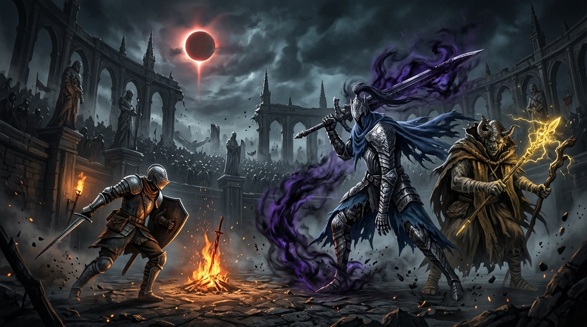
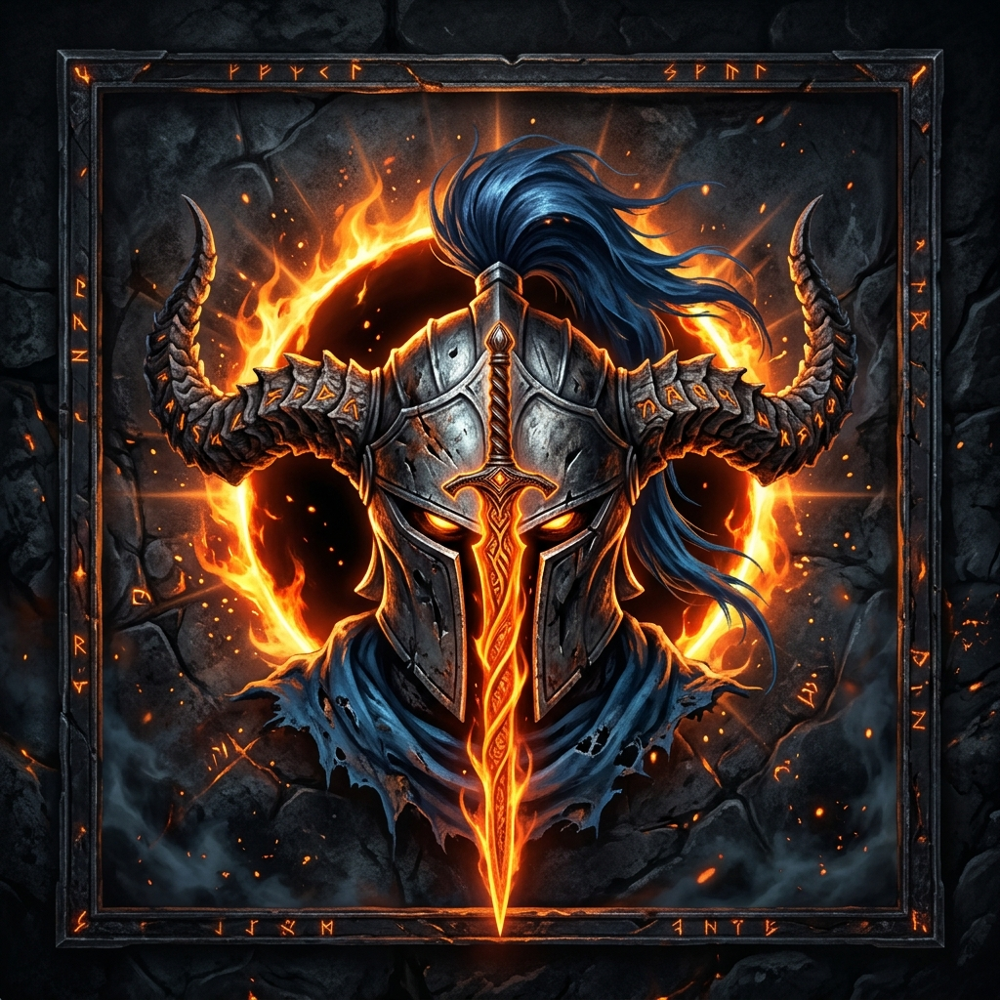
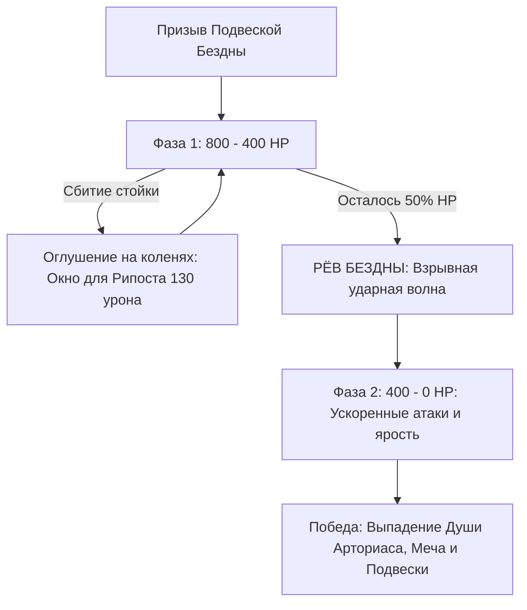

# Dark Souls Bossfight Minecraft mod (Elden Ring Combat)

<div align="center">



<br/>

[](https://github.com/smeshar/minecraft-dark-souls/releases/tag/v1.1.1)
[](https://github.com/smeshar/minecraft-dark-souls/releases/download/v1.1.1/artorias-boss-1.1.1.jar)
[](https://www.minecraft.net/)
[](https://fabricmc.net/)
[](https://modrinth.com/mod/fabric-api)
[](https://adoptium.net/)
[](#-кооператив-с-друзьями-по-сети-lan)
[](#-боевые-механики-elden-ring)

<p align="center">
  <b>Босс Dark Souls Рыцарь Арториас Путник Бездны в Minecraft с боевой системой из Elden Ring!</b><br/>
  <i>Стойка, оглушение, критические рипосты, перекаты с кадрами неуязвимости (i-frames), атака в падении (Ground Slam), 2 фазы боя и 800 HP для битв с друзьями по локальной сети!</i>
</p>

</div>

---

## Системные требования и версия игры

> [!IMPORTANT]
> ### Требуемая версия: **Minecraft 1.21.11 (FABRIC)**
> - **Minecraft:** `1.21.11`.
> - **Fabric:** `Fabric Loader 0.16.10` или новее.
> - **Fabric API:** `Fabric API 0.141.3+1.21.11` or greater.
> - **Совместимость:** Полная поддержка одиночной игры и **игры по сети с друзьями (Открыть для сети / Open to LAN, Radmin VPN, Hamachi)**

---

## Обзор мода

Мод переносит одного из самых культовых боссов серии **Dark Souls** - **Рыцаря Арториаса** — прямиком в Minecraft, объединяя его непредсказуемый стиль боя с лучшими боевыми механиками **Elden Ring**:

<div align="center">
  
</div>

### Основные особенности:

| Характеристика | Значение | Описание |
| :--- | :--- | :--- |
| **Здоровье босса** | **800 HP** | Полоска босс-бара на 10 сегментов, сбалансировано для пати из 2-5 игроков |
| **Система баланса** | **150 Poise** | Удары в прыжке и тяжелое оружие сбивают стойку босса |
| **Критический рипост** | **130 Урона** | Наносится в момент, когда ошеломлённый босс падает на колени |
| **Перекат игрока** | **Клавиша `Left Alt`** | 0.4 секунды полной неуязвимости к любым ударам и взрывам (i-frames) с HUD-индикатором |
| **Удар о землю (Ground Slam)** | **В воздухе + `Ctrl`** | Сокрушительное падение с уроном по площади (4.5 блока), кастомной анимацией, звуком булавы и Dark Souls HUD |
| **Фазы боя** | **2 Фазы** | При 50% HP активируется взрывной Рёв Бездны и постоянный бафф скорости и ярости |

---

## Боевые механики Elden Ring

### 1. Stance Break & Poise (Баланс и пробитие стойки)
У Арториаса есть невидимая шкала стойкости (150 единиц).
- **Обычные удары:** снимают 10–15 стойкости.
- **Удары в прыжке (Jump Attacks) и тяжелые атаки:** наносят **35–50 урона по стойкости**.
- **Оглушение (Stagger):** Когда шкала истощается, раздаётся громкий звон наковальни, и Арториас **падает на колени на 6 секунд**.
- **Рипост (Critical Riposte):** Любой удар по стоящему на коленях Арториасу наносит сокрушительные **130 чистого урона** со спецэффектами взрыва!

### 2. Dodge Roll (Перекат с неуязвимостью)
- Нажмите **`Левый Alt`** (клавиша настраивается в меню «Настройки» ➔ «Управление» ➔ раздел «Movement / Движение»).
- Персонаж совершает быстрый сбалансированный кувырок в направлении взгляда, расходуя немного полоски сытости.
- Во время первых **0.4 сек (8 тиков)** персонаж получает **полный иммунитет к урону** (i-frames), что позволяет прокатываться сквозь размашистые удары клинка и ударные волны!
- Слева от хотбара отображается симметричный HUD: статус готовности `🛡 ROLL READY`, индикатор активной неуязвимости `⚡ i-FRAMES`, таймер кулдауна и предупреждение об истощении `NO STAMINA`.

### 3. Ground Slam / Plunge Attack (Сокрушительный удар о землю в падении)
- Находясь в воздухе (в прыжке или при падении), нажмите **`Ctrl`** (клавиша настраивается в управлении: «Ground Slam»).
- Персонаж стремительно устремляется вертикально вниз в классической позе Plunging Attack с опущенным острием клинка.
- **Урон по площади (AoE):** В радиусе **4.5 блоков** наносит **14 урона** (или **24 урона**, если в руках Двуручный Меч Арториаса) и мощно подбрасывает врагов в воздух.
- **Иммунитет к падению:** Игрок полностью защищен от урона от падения при завершении этого удара.
- **Анимации и эффекты:**
  - Приземление сопровождается брутальной стойкой на колене (superhero landing pose).
  - Ударная волна `GUST_EMITTER_LARGE`, кольцо пламени Бездны и разлетающиеся осколки блоков поверхности.
  - Камера игрока получает сочную вертикальную отдачу удара.
- **Dark Souls HUD (Перезарядка 5 секунд):**
  - Справа от хотбара отображается стильный виджет перезарядки.
  - Во время перезарядки отображается заполняющаяся шкала Бездны и таймер с десятыми долями секунды (`SLAM 4.2s`).
  - В воздухе виджет пульсирует лазурным свечением с подсказкой `⚡ [CTRL] SLAM`.
  - При готовности раздается легкий звон готовности способности.

---

## Босс-файт: Фазы и атаки Арториаса



### Приёмы Арториаса:
1. **Somersault Flip Slam (Сальто с ударом):** высокий прыжок в воздух с переворотом и сокрушительное падение клинка в землю с взрывной ударной волной.
2. **Gliding Pierce Lunge (Скользящий выпад):** стремительный рывок сквозь арену, пронзающий игроков на своём пути.
3. **Abyss Spin Slash (Круговой вихрь 360°):** резкий разворот с мечом, отбрасывающий всех столпившихся вокруг игроков.
4. **Abyss Sludge Throw (Бросок скверны):** если игроки держатся далеко, Арториас выбрасывает сгусток тёмной слизи Бездны.
5. **Phase 2 Abyss Buff (50% HP):** Арториас останавливается, впитывает тьму и издает яростный рев, порождающий мощный взрывной вихрь вокруг себя, после чего его скорость и урон возрастают до конца боя.

---

## Предметы и трофеи

| Предмет | Описание |
| :--- | :--- |
| **Подвеска Бездны**<br/>`artorias:abyssal_pendant` | Предмет призыва. Нажмите ПКМ по земле, чтобы призвать Арториаса в эпическом шторме молний и частиц тьмы. Гарантированно выпадает с босса при победе! |
| **Большой меч Арториаса**<br/>`artorias:artorias_greatsword` | Легендарный двуручник (+12 урона). **ПКМ:** Особый приём — высокий прыжок вперед с сальто и сокрушительным взрывом Бездны (24 AOE урона + тяжелый урон по стойке врагов)! Выпадает при победе. |
| **Душа Арториаса**<br/>`artorias:soul_of_artorias` | Драгоценная эссенция побеждённого рыцаря, выпадающая после завершения босс-файта. Используется для создания Шлема Арториаса на верстаке. |
| **Шлем Арториаса**<br/>`artorias:artorias_helm` | Легендарный рыцарский шлем Путника Бездны с развевающимся кобальтовым султаном. Создаётся объединением **Души Арториаса** и **Алмазного шлема** на верстаке. Обладает всеми характеристиками алмазного шлема (+3 Броня, +2 Твёрдость брони, 363 прочности), но дополнительно дарует **+5 к урону** в ближнем бою! |
| **Сухпаёк Бездны**<br/>`artorias:soul_ration` | Универсальная боевая провизия. **Съедается одним нажатием (1 клик)** и мгновенно восполняет 6 единиц сытости и 14.4 насыщения (как золотая морковь)! Дропается со всех новых агрессивных мобов. |

---

## Агрессивные мобы (Elden Ring & Dark Souls)

Все новые мобы обладают сложным тактическим ИИ, индивидуальными 3D-моделями, уникальными анимациями, звуками и дропают **Сухпаёк Бездны**:

### 1. Варги (Мувсет волков из Elden Ring)
- **Большой варг (`artorias:giant_warg`)** — 60 HP, свирепый гигантский хищник.
- **Малый варг (`artorias:lesser_warg`)** — 24 HP, быстрый и ловкий охотник.
- **Особенности и атаки:**
  - **Pounce Lunge (Прыжок с наскока):** на дистанции 4–10 блоков варг группируется и совершает стремительный прыжок сквозь воздух, сбивая с ног.
  - **Flanking / Circling (Тактическое окружение):** стая не бежит по прямой, а кружит полукругом вокруг игрока, выжидая момент для удара со спины.
  - **Dire Howl (Боевой рёв):** Большой варг издаёт леденящий кровь вой, накладывая Силу и Скорость на себя и всю стаю.
  - **Bite Combo:** молниеносная серия укусов в ближнем бою.

### 2. Огры-знамения (Мувсет Знамений из канализации Лейнделла)
- **Огр-знамение с тесаком (`artorias:omen_cleaver`)** — 140 HP, массивный рогатый громила с гигантским ржавым тесаком.
- **Бешеный огр-кулачник (`artorias:omen_brawler`)** — 120 HP, свирепый огр в шипованных цестусах.
- **Особенности и атаки:**
  - **Overhead Cleaver Slam:** замах тесаком обеими руками с сокрушительным падением в землю и ударной волной (AoE взрыв).
  - **Cursed Flame Breath:** наклон вперед и выдыхание конуса тёмного проклятого пламени, поджигающего врагов.
  - **Omen Kick & Stomp:** тяжелый пинок ногой (сбивает блок щитом) и топот о землю, подбрасывающий противников в воздух.
  - **Система баланса (Poise 70):** огры оглушаются и падают на колено при серии тяжелых ударов, открывая окно для атаки.

### 3. Гоблины и рыцари-гоблины
- **Гоблин-лазутчик (`artorias:goblin`)** — 20 HP, мелкий, юркий и злобный противник.
  - **Dagger Flurry:** серия быстрых уколов кинжалом.
  - **Agile Dodge Roll (Акробатический отскок):** при получении урона с 45% шансом совершает мгновенный кувырок назад или вбок с кадрами неуязвимости!
- **Рыцарь-гоблин (`artorias:goblin_knight`)** — 45 HP, бронированный гоблин в ведре-шлеме с мечом и шипованным баклером.
  - **Shield Guard & Parry Counter:** поднимает щит в стойку защиты. При атаке в щит спереди парирует удар со звуком блока и проводит **мгновенную критическую контратаку (рипост)**!
  - **Shield Bash:** сокрушительный удар щитом, накладывающий замедление.

---

## Кооператив с друзьями по сети (LAN)

Для игры с друзьями **не нужен платный сервер**!

1. **Скопируйте мод:**
   - Поместите `artorias-boss-1.1.1.jar` в папку `.minecraft/mods` у себя и у всех друзей.
   - Убедитесь, что у всех установлен `fabric-api-0.141.3+1.21.11.jar`.
2. **Создайте мир:**
   - Зайдите в одиночную игру.
   - Постройте арену (рекомендуется открытая площадка 30x30 блоков или более).
3. **Откройте мир для сети:**
   - Нажмите `Esc` ➔ **«Открыть для сети» (Open to LAN)**.
   - Если вы играете через одну Wi-Fi сеть — друзья увидят ваш сервер во вкладке «Сетевая игра».
   - Если вы в разных городах — подключитесь к одной комнате в **Radmin VPN** или **Hamachi**, и друзья смогут подключиться по вашему виртуальному IP-адресу с указанным в чате портом (например: `26.x.x.x:54321`).
4. **Начните бой:**
   - Возьмите **Подвеску Бездны** и кликните ПКМ в центре арены.
   - Координируйте атаки: пока один игрок отвлекает Арториаса и перекатывается через сальто на `Left Alt`, остальные выполняют удары в прыжке для сбития стойки!

---

## Управление по умолчанию

| Действие | Клавиша | Описание |
| :--- | :---: | :--- |
| **Dodge Roll (Перекат)** | `Left Alt` | Быстрый кувырок с 0.4 сек кадров неуязвимости (i-frames) |
| **Ground Slam (Удар о землю)** | `Ctrl` (в воздухе) | Сокрушительное падение с уроном по площади 4.5 блока (кулдаун 5 сек) |
| **Special Weapon Skill** | `ПКМ` (с мечом Арториаса) | Прыжок с сальто и сокрушительным взрывом Бездны (перезарядка 4 сек) |
| **Summon Boss** | `ПКМ` (с Подвеской) | Призыв Арториаса на выбранном блоке |

---

## Сборка из исходников

Если вы хотите собрать мод самостоятельно:

```powershell
# Клонируйте репозиторий
git clone https://github.com/smeshar/MinecraftDarkSouls.git
cd MinecraftDarkSouls

# Скомпилируйте мод с помощью Gradle Wrapper (требуется Java 21 или Java 25)
.\gradlew.bat build
```
Готовый `.jar` файл будет создан в папке `build/libs/artorias-boss-1.1.1.jar`.
 
---

<div align="center">
  <sub>Разработано для истинных ценителей Dark Souls и Elden Ring в Minecraft. Да не поглотит вас Бездна</sub>
</div>
