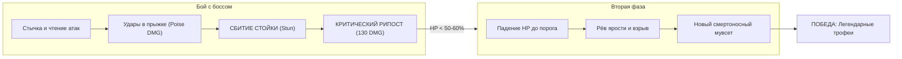
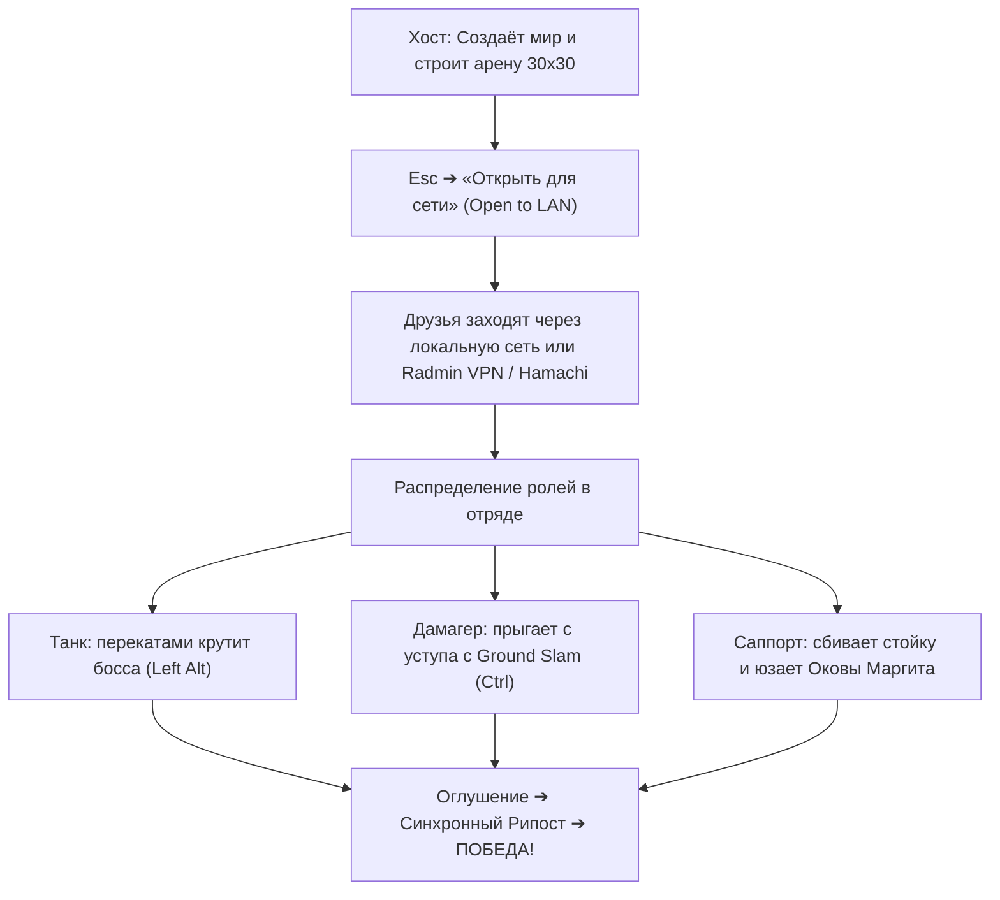

# MinecraftDarkSouls (Dark Souls & Elden Ring Combat)

<div align="center">


<br/>

[](https://github.com/smeshar/MinecraftDarkSouls/releases)
[](https://www.minecraft.net/)
[](https://fabricmc.net/)
[](https://modrinth.com/mod/fabric-api)
[](https://modrinth.com/mod/geckolib)
[](https://adoptium.net/)
[](#-кооператив-с-друзьями-по-сети-lan)

<p align="center">
  
  <br/>
  <b>Dark Souls и Elden Ring в мире Minecraft!</b><br/>
  <i>Забудьте о банальном закликивании мечом. Время тактических перекатов с кадрами неуязвимости, сокрушительных ударов о землю в падении, сбития стойки гигантов и смертоносных критических рипостов на коленях.</i>
</p>

</div>

---

> [!IMPORTANT]
> ### Системные требования:
> - **Minecraft:** `1.21.1` (Fabric)
> - **Fabric Loader:** `0.20.1` или новее
> - **Fabric API:** `0.116.17+1.21.1`
> - **GeckoLib:** `4.7.4` (для высокодетализированных анимаций и моделей боссов)
> - **Java:** `21` или `25`
> - **Режим игры:** Полная поддержка одиночной игры и **кооператива с друзьями (Open to LAN, Radmin VPN, Hamachi)**

---

## О чём этот мод? Реальный игровой опыт

В ванильном Minecraft бой сводится к тупому обмену ударами: кто накликает больше урона или съест больше золотых яблок. **MinecraftDarkSouls кардинально меняет правила игры.**

Здесь каждое движение требует расчёта:

```
  Обычное закликивание  ❌  ──►  Смерть за 2 секунды от сальто Арториаса
  Soulsborne Тайминг   ✔️  ──►  Перекат сквозь лезвие (i-frames) ➔ Удар в прыжке ➔ Оглушение ➔ РИПОСТ!
```

### Как ощущается игра:
1. **Тайминг превыше брони:** Даже в полной алмазной броне боссы и элитные огры способны разорвать вас за пару неверных шагов. Единственное истинное спасение — клавиша **`Left Alt`** (Dodge Roll). Первые **0.4 секунды** кувырка даруют абсолютный иммунитет к урону (i-frames), позволяя прокатываться прямо сквозь 360-градусный вихрь Бездны или золотой молот Маргита.
2. **Вертикальность и сокрушение:** Спрыгивая с уступа или находясь в прыжке, нажмите **`Ctrl`** — персонаж с режущим свистом устремится в землю в позе **Ground Slam**. Никакого урона от падения: вместо этого поверхность взрывается каменными осколками, подбрасывая врагов в воздух в радиусе 4.5 блоков!
3. **Звон наковальни и рипост:** У каждого босса и крупного монстра есть скрытая шкала стойкости (Poise). Проводите тяжелые атаки и удары в прыжке. Когда баланс ломается, раздаётся характерный звон Dark Souls, босс валится на колено, а ваш следующий удар активирует **Критический Рипост (120–130 чистого урона)** с ослепительным взрывом!

---

## Боевая система нового поколения

```
┌─────────────────────────────────────────────────────────────────────────────┐
│                             БОЕВОЙ HUD И ТАЙМИНГИ                            │
├─────────────────────────────────────────────────────────────────────────────┤
│  [ 🛡 ROLL READY ]  ──( Нажатие Left Alt )──►  [ ⚡ i-FRAMES 0.4s ] ──► [ ⏳ CD ] │
│  [ ⚡ [CTRL] SLAM ] ──( В воздухе )────────►  [ 💥 IMPACT AoE ]   ──► [ 4.2s ]   │
└─────────────────────────────────────────────────────────────────────────────┘
```

### 1. Dodge Roll — Перекат с кадрами неуязвимости (i-frames)
- **Активация:** Клавиша **`Left Alt`** (настраивается в *Настройки ➔ Управление ➔ Движение*).
- **Механика:** Персонаж совершает направленный бросок в сторону движения (или назад, если клавиши направления не зажаты).
- **Кадры неуязвимости (i-frames):** **8 тиков (0.4 секунды)** абсолютной защиты от всех видов физического, магического урона и взрывов.
- **HUD-индикатор:** Слева от панели хотбара отображается статус готовности:
  - `ROLL READY` — готов к выполнению.
  - `i-FRAMES` — активна фаза неуязвимости.
  - `NO STAMINA` — блокировка при голоде (требуется более 1 единицы сытости).

### 2. Ground Slam — Сокрушительный удар о землю в падении
- **Активация:** Находясь в воздухе (в прыжке или падая с высоты), нажмите **`Ctrl`**.
- **Механика:** Стремительное пикирование острием меча в землю.
- **Эффекты приземления:**
  - **Полный иммунитет** к урону от падения при завершении приёма.
  - **AoE-урон в радиусе 4.5 блоков:** 14 базового урона (или **24 урона**, если в руках Двуручный Меч Арториаса).
  - Мощная ударная волна, раскидывающая противников в стороны.
  - Кастомная анимация приземления на колено (landing pose) и эффект сотрясения камеры.
- **Виджет перезарядки:** Справа от хотбара пульсирует Dark Souls индикатор кулдауна (5 секунд). При нахождении в воздухе появляется подсказка `⚡ [CTRL] SLAM`.

### 3. Stance Break & Critical Riposte (Пробитие стойки и рипост)
- Обычные тычки мечом снимают 10–15 стойкости.
- **Удары в прыжке (Jump Attacks):** наносят **35–50 урона по балансу**.
- При истощении шкалы стойкости враг замирает на коленях в стане:
  - Удар по стоящему на коленях боссу наносит **120–130 урона**.
  - Сопровождается взрывной волной частиц и звуком сокрушительного рипоста.

---

## Легендарные Боссы



### Сравнительная таблица боссов:

| Параметр | Рыцарь Арториас Путник Бездны | Маргит, Ужасное Знамение |
| :--- | :--- | :--- |
| **Здоровье (HP)** | **800 HP** (10 секций босс-бара) | **850 HP** (10 секций босс-бара) |
| **Баланс (Poise)** | 150 единиц (стабильный рыцарь) | 120 единиц (сбивается прыжками) |
| **Окно стана** | 6 секунд на коленях | 4.5 секунды на коленях |
| **Вторая фаза** | При **50% HP** (Рёв Бездны, бафф скорости) | При **60% HP** (Золотой Молот и ярость) |
| **Ключевой трюк** | Акробатические сальто и вихри 360° | Задержки ударов и хвост при заходе за спину |
| **Специальный контр-предмет** | Перекат через сальто и Ground Slam | **Оковы Маргита** (прижимают к земле) |
| **Главный дроп** | Меч Арториаса, Душа Арториаса, Кулон | Опыт (8000 XP) и боевая слава |

---

### 1. Рыцарь Арториас Путник Бездны (`artorias:knight_artorias`)

Один из Четырёх Рыцарей Гвина, поглощённый тьмой Бездны в руинах Олачиля.

<div align="center">
  
</div>

- **Призыв:** Возьмите **Кулон Бездны (`artorias:abyssal_pendant`)** и нажмите ПКМ по земле на подготовленной арене.
- **Опасные приёмы:**
  - **Somersault Flip Slam:** взмывает высоко в воздух, крутит сальто и сокрушительно вбивает меч в землю с взрывной волной.
  - **Gliding Pierce Lunge:** молниеносный скользящий выпад через всю арену.
  - **Abyss Spin Slash:** мгновенный оборот на 360°, сбивающий всех окруживших игроков.
  - **Abyss Sludge Throw:** бросок тёмной скверны в игроков на дальней дистанции.
  - **Phase 2 Abyss Buff:** при 50% HP замирает и издаёт леденящий рёв Бездны с мощным взрывом — его скорость и агрессия возрастают до максимума!

---

### 2. Маргит, Ужасное Знамение (`artorias:margit_the_fell_omen`)

Страж ворот Лейнделла, мастер обманных замахов и спектрального золотого оружия.

- **Спавн:** Через яйцо призыва (`artorias:margit_spawn_egg`) или команду `/summon artorias:margit_the_fell_omen`.
- **Опасные приёмы:**
  - **Staff Swing Combo с задержкой:** фирменные задержки замаха посохом из Elden Ring, наказывающие за панический перекат.
  - **Staff Leap:** стремительный прыжок через арену с тяжелым ударом о землю.
  - **Spectral Dagger Toss:** метание двух светящихся золотых кинжалов при попытке выпить зелье или отойти.
  - **Tail Swipe (Анти-бэкстаб):** если игрок перекатывается боссу за спину, Маргит мгновенно хлещет мощным хвостом на 360°!
  - **Phase 2 Golden Hammer Slam:** на 60% HP призывает гигантский золотой молот и обрушивает его с высоты, раскалывая землю.
- **Оковы Маргита (`artorias:margits_shackle`):** Легендарный артефакт! Примените в 1-й фазе, чтобы приковать Маргита к земле золотыми цепями на 3 секунды (до 2 раз за бой). Во 2-й фазе оковы бессильны!

---

## Бестиарий Верхнего и Подземного мира

Новые враги естественным образом населяют биомы, обладая уникальным ИИ стаи, уклонениями и парированием:

```
┌───────────────────────┬────────────────────────────────────────────────────────┐
│ Моб                   │ Особенности поведения и опасность                      │
├───────────────────────┼────────────────────────────────────────────────────────┤
│ 🐺 Большой варг       │ 60 HP. Боевой рёв стаи (Dire Howl), наскок с 10 блоков │
│ 🐕 Малый варг         │ 24 HP. Тактическое окружение полукольцом, комбо укусов │
│ 👹 Огр с тесаком      │ 140 HP. Сокрушительный удар в землю, огненное дыхание  │
│ 🥊 Огр-кулачник       │ 120 HP. Пинок, пробивающий щит, топот с подбрасыванием │
│ 🗡️ Гоблин-лазутчик    │ 20 HP. Акробатический перекат с i-frames при ударе     │
│ 🛡️ Рыцарь-гоблин      │ 45 HP. Парирует удары в щит и проводит ответный рипост │
└───────────────────────┴────────────────────────────────────────────────────────┘
```

---

## Арсенал, Реликвии и Крафт

| Иконка | Название и ID | Способ получения | Свойства и боевые навыки |
| :---: | :--- | :--- | :--- |
| ⚔️ | **Двуручный Меч Арториаса**<br/>`artorias:artorias_greatsword` | Дроп с Арториаса | +12 к урону. **ПКМ:** Сальто вперед с сокрушительным взрывом Бездны (24 AoE урона + тяжелый урон по стойке). |
| 🪖 | **Шлем Арториаса**<br/>`artorias:artorias_helm` | Верстак: **Душа Арториаса** + **Алмазный шлем** | Защита алмазного шлема, но дополнительно дарует **+5 к чистому урону в ближнем бою**! Развевающийся султан. |
| ⛓️ | **Оковы Маргита**<br/>`artorias:margits_shackle` | Творческий инвентарь / Данжи | Приковывает Маргита к земле золотыми цепями в 1-й фазе боя (до 2 использований). |
| 🔮 | **Кулон Бездны**<br/>`artorias:abyssal_pendant` | Стартовый крафт / Дроп | ПКМ по блоку призывает Рыцаря Арториаса в шторме тёмных молний. |
| 🥩 | **Сухпаёк Бездны**<br/>`artorias:soul_ration` | Дроп со всех мобов мода | **Съедается в 1 клик!** Мгновенно восполняет 6 единиц сытости и насыщение (быстрее золотой моркови). |

---

## Кооператив с друзьями по сети (LAN)

Мод полностью оптимизирован для мультиплеера — никакого платного хостинга не требуется!



### Пошаговый запуск:
1. Установите `MinecraftDarkSouls-2.0.0-beta.1.jar`, `fabric-api` и `geckolib` в папку `.minecraft/mods` у всех игроков.
2. Хост заходит в одиночный мир, строит арену и нажимает **`Esc` ➔ «Открыть для сети»**.
3. Если вы в разных городах — подключитесь к одной комнате в **Radmin VPN** и друзья вводят IP хоста с указанным портом (например: `26.15.42.11:51234`).
4. Призовите Арториаса или Маргита и координируйте атаки по голосовой связи!

---

## ⌨Управление по умолчанию

| Действие | Клавиша | Описание |
| :--- | :---: | :--- |
| **Dodge Roll (Перекат)** | `Left Alt` | Быстрый кувырок с 0.4 сек кадров неуязвимости (i-frames) |
| **Ground Slam (Удар о землю)** | `Ctrl` *(в воздухе)* | Сокрушительное падение с уроном по площади 4.5 блока (кд 5 сек) |
| **Flip Slam (Спец-атака меча)** | `ПКМ` *(с мечом)* | Прыжок с сальто и взрывом Бездны на 24 урона |
| **Оковы Маргита** | `ПКМ` *(рядом с боссом)* | Приковать Маргита к земле в 1-й фазе |
| **Призыв Арториаса** | `ПКМ` *(с Кулоном)* | Ритуал пробуждения босса на выбранном блоке |

---

## Сборка из исходников

```powershell
# Клонируйте репозиторий
git clone https://github.com/smeshar/MinecraftDarkSouls.git
cd MinecraftDarkSouls

# Скомпилируйте проект с помощью Gradle Wrapper (требуется Java 21 или Java 25)
.\gradlew.bat build
```
Готовый артефакт появится по пути: `build/libs/MinecraftDarkSouls-2.0.0-beta.1.jar`.

---

<div align="center">
  <sub>Создано с любовью к Dark Souls и Elden Ring. Да не угаснет ваше пламя! 🔥</sub>
</div>
